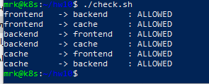
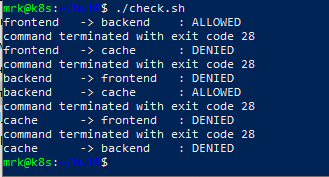
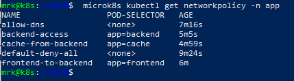
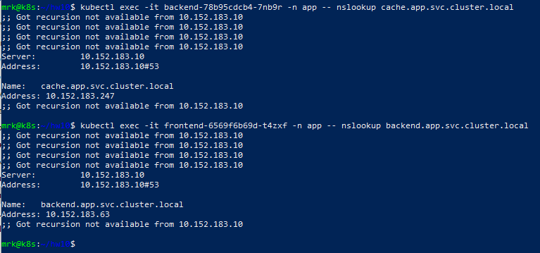
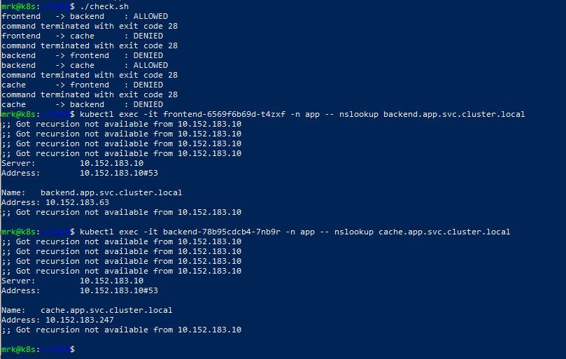

# Домашнее задание к занятию «Как работает сеть в K8s»

## Задание 1. Настройка NetworkPolicy

Цель работы — настроить сетевые политики Kubernetes таким образом, чтобы была разрешена только следующая цепочка взаимодействия приложений:

```text
frontend  --->  backend  --->  cache
```

Другие соединения между приложениями должны быть запрещены.

---

## Окружение

Для выполнения задания использовался существующий Kubernetes-кластер MicroK8s.

| Параметр | Значение |
|---|---|
| Kubernetes | MicroK8s v1.35.6 |
| ОС | Ubuntu 26.04 LTS |
| Node | `k8s` |
| IP node | `153.51.115.75` |
| Container Runtime | containerd 2.1.6 |
| CNI | Calico |
| Namespace | `app` |
| Образ приложений | `wbitt/network-multitool:latest` |

Calico используется как сетевой плагин и обеспечивает применение Kubernetes NetworkPolicy.

---

## Созданные приложения

В namespace `app` созданы три Deployment:

- `frontend`;
- `backend`;
- `cache`.

Для каждого Deployment создан отдельный Service типа `ClusterIP`.

Манифест приложений:

[`application.yaml`](application.yaml)

После запуска приложения работают в отдельных Pod:

```text
backend    1/1 Running
cache      1/1 Running
frontend   1/1 Running
```

Сервисы приложений:

```text
backend    ClusterIP   10.152.183.63    80/TCP
cache      ClusterIP   10.152.183.247    80/TCP
frontend   ClusterIP   10.152.183.161   80/TCP
```


---

## Проверка сети до применения NetworkPolicy

До создания политик в namespace `app` NetworkPolicy отсутствовали.

проверка выполняется самописным скриптом на баш.

[`check.sh`](check.sh)

```check.sh
#!/bin/bash
NS=app
SERVICES="frontend backend cache"

for src in $SERVICES; do
  for dst in $SERVICES; do
    [ "$src" = "$dst" ] && continue
    if microk8s kubectl exec -n "$NS" deploy/"$src" -- curl -s -o /dev/null -m 3 http://"$dst"; then
      res=ALLOWED
    else
      res=DENIED
    fi
    printf "%-10s -> %-10s : %s\n" "$src" "$dst" "$res"
  done
done
```


Проверка соединений показала, что все направления были доступны:

```text
frontend   -> backend    : ALLOWED
frontend   -> cache      : ALLOWED
backend    -> frontend   : ALLOWED
backend    -> cache      : ALLOWED
cache      -> frontend   : ALLOWED
cache      -> backend    : ALLOWED
```

Таким образом, до применения политик сетевой доступ между приложениями не был ограничен.


---

## Настройка NetworkPolicy

Для реализации требуемой схемы созданы пять политик.

### 1. Default Deny

Файл:

[`network-policy-default-deny.yaml`](network-policy-default-deny.yaml)

Политика выбирает все Pod namespace `app`:

```yaml
podSelector: {}
policyTypes:
  - Ingress
  - Egress
```

После её применения ingress и egress для Pod запрещены, если доступ явно не разрешён другими NetworkPolicy.

### 2. Разрешение DNS

Файл:

[`network-policy-dns.yaml`](network-policy-dns.yaml)

После запрета egress приложениям отдельно разрешён доступ к CoreDNS:

```text
app/* ---> kube-system/CoreDNS

UDP/53
TCP/53
```

CoreDNS выбирается по labels:

```text
namespace:
kubernetes.io/metadata.name=kube-system

pod:
k8s-app=kube-dns
```

### 3. Frontend -> Backend

Файл:

[`network-policy-frontend.yaml`](network-policy-frontend.yaml)

Для `frontend` разрешён исходящий TCP-трафик на порт `80` только к Pod с label:

```text
app=backend
```

```text
frontend ---> backend:80
```

### 4. Backend

Файл:

[`network-policy-backend.yaml`](network-policy-backend.yaml)

Ingress:

```text
frontend ---> backend:80
```

Egress:

```text
backend ---> cache:80
```

### 5. Cache

Файл:

[`network-policy-cache.yaml`](network-policy-cache.yaml)

Для `cache` разрешён входящий TCP-трафик на порт `80` только от Pod с label:

```text
app=backend
```

```text
backend ---> cache:80
```

---

## Итоговая схема доступа

```text
                TCP/80                 TCP/80
frontend  ----------------> backend ----------------> cache
```

Дополнительно всем Pod разрешён DNS-трафик к CoreDNS.

Остальные соединения между `frontend`, `backend` и `cache` запрещены.


---

## Созданные NetworkPolicy

```text
NAME                  POD-SELECTOR
allow-dns             <none>
backend-access        app=backend
cache-from-backend    app=cache
default-deny-all      <none>
frontend-to-backend   app=frontend
```


---

## Проверка DNS после применения политик

Frontend разрешает имя backend:

```text
backend.app.svc.cluster.local
Address: 10.152.183.61
```

Backend разрешает имя cache:

```text
cache.app.svc.cluster.local
Address: 10.152.183.17
```


---

## Проверка разрешённого и запрещённого трафика

```text
--- REQUIRED CONNECTIONS ---

frontend   -> backend    : ALLOWED
backend    -> cache      : ALLOWED

--- FORBIDDEN CONNECTIONS ---

frontend   -> cache      : DENIED
backend    -> frontend   : DENIED
cache      -> backend    : DENIED
cache      -> frontend   : DENIED
```

Разрешена только требуемая цепочка:

```text
frontend -> backend -> cache
```


---

## Скриншоты

### Состояние кластера, приложений, сервисов и NetworkPolicy


### Проверка разрешённых и запрещённых соединений



---

## Файлы

```text
.
├── README.md
├── application.yaml
├── network-policy-backend.yaml
├── network-policy-cache.yaml
├── network-policy-default-deny.yaml
├── network-policy-dns.yaml
├── network-policy-frontend.yaml
└── check.sh
```

---

## Результат

С помощью Calico и Kubernetes NetworkPolicy настроена схема:

```text
frontend -> backend -> cache
```

При этом:

- `frontend -> backend` разрешён;
- `backend -> cache` разрешён;
- `frontend -> cache` запрещён;
- `backend -> frontend` запрещён;
- `cache -> backend` запрещён;
- `cache -> frontend` запрещён;
- DNS-доступ к CoreDNS сохранён.

Требования задания выполнены.
