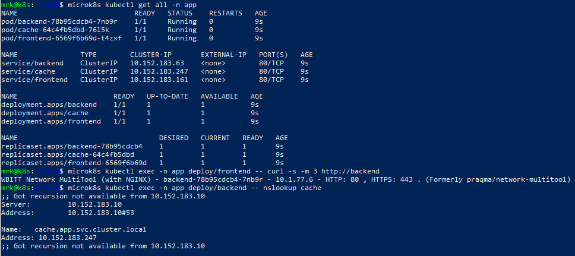

# Домашнее задание к занятию «Как работает сеть в K8s»

## Задание 1. Настройка NetworkPolicy

Цель работы — настроить сетевые политики Kubernetes таким образом, чтобы была разрешена только следующая цепочка взаимодействия приложений:

```text
frontend  --->  backend  --->  cache
```

Другие соединения между приложениями должны быть запрещены.

---

## Окружение

Для выполнения задания использовался существующий Kubernetes-кластер MicroK8s.

| Параметр | Значение |
|---|---|
| Kubernetes | MicroK8s v1.35.6 |
| ОС | Ubuntu 26.04 LTS |
| Node | `k8s` |
| IP node | `153.51.115.75` |
| Container Runtime | containerd 2.1.6 |
| CNI | Calico |
| Namespace | `app` |
| Образ приложений | `wbitt/network-multitool:latest` |

Calico используется как сетевой плагин и обеспечивает применение Kubernetes NetworkPolicy.

---

## Созданные приложения

В namespace `app` созданы три Deployment:

- `frontend`;
- `backend`;
- `cache`.

Для каждого Deployment создан отдельный Service типа `ClusterIP`.

Манифест приложений:

[`application.yaml`](application.yaml)

После запуска приложения работают в отдельных Pod:

```text
backend    1/1 Running
cache      1/1 Running
frontend   1/1 Running
```

Сервисы приложений:

```text
backend    ClusterIP   10.152.183.63    80/TCP
cache      ClusterIP   10.152.183.247    80/TCP
frontend   ClusterIP   10.152.183.161   80/TCP
```


---

## Проверка сети до применения NetworkPolicy
