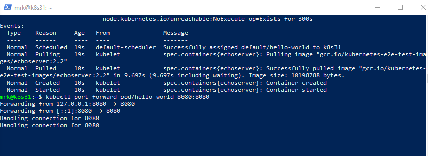
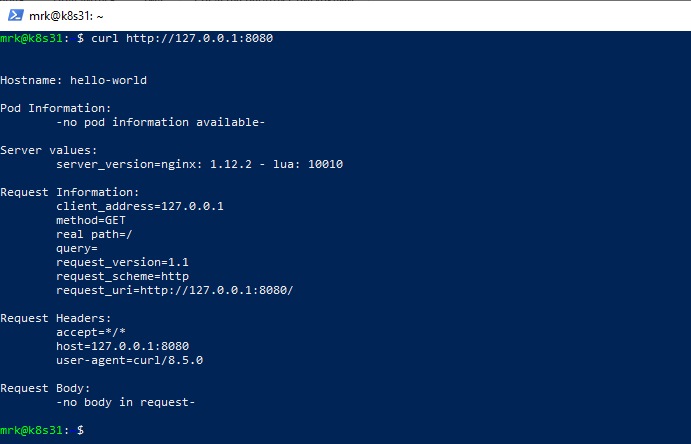
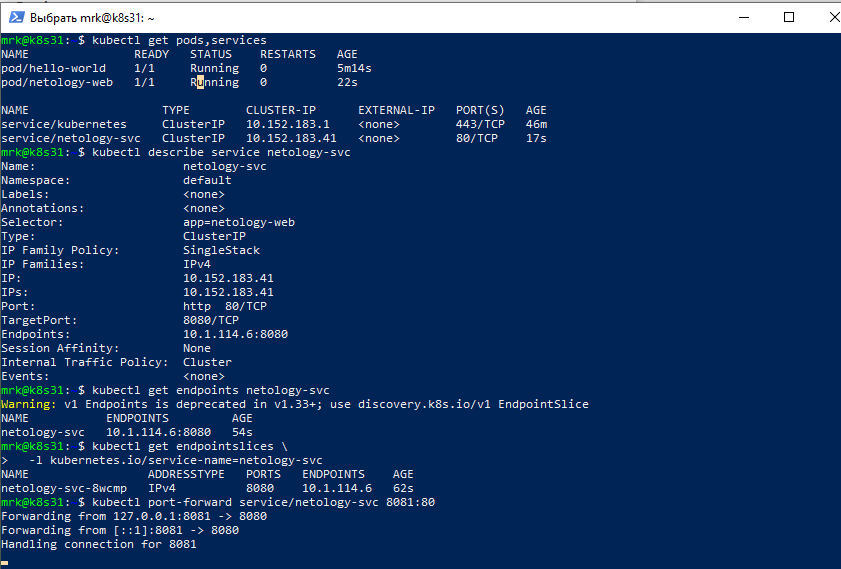
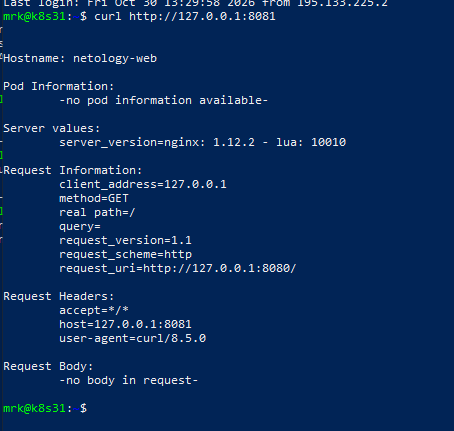

# Домашнее задание: Базовые объекты K8S

## Цель работы

В тестовой среде Kubernetes развернуть Pod с приложением, подключиться к нему с локального компьютера, затем создать Service для доступа к другому Pod и проверить подключение через `kubectl port-forward`.

## Используемые инструменты

- Kubernetes-кластер: MicroK8s или другое совместимое решение;
- локальный `kubectl`;
- редактор YAML-файлов;
- Git;
- `curl` или браузер.

## Структура репозитория

```text
.
├── README.md
└── manifests
    ├── hello-world.yaml
    ├── netology-web.yaml
    └── netology-svc.yaml
```

## Предварительная проверка

Проверка доступности Kubernetes-кластера:

```bash
kubectl cluster-info
kubectl get nodes
```

Пример ожидаемого результата:

```text
NAME       STATUS   ROLES           AGE   VERSION
microk8s   Ready    control-plane   ...   ...
```

---

# Задание 1. Создание Pod `hello-world`

## Манифест Pod

Файл манифеста: [`manifests/hello-world.yaml`](manifests/hello-world.yaml)

```yaml
apiVersion: v1
kind: Pod
metadata:
  name: hello-world
  labels:
    app: hello-world
spec:
  containers:
    - name: echoserver
      image: gcr.io/kubernetes-e2e-test-images/echoserver:2.2
      ports:
        - name: http
          containerPort: 8080
          protocol: TCP
```

## Создание Pod

```bash
kubectl apply -f manifests/hello-world.yaml
```

Проверка состояния Pod:

```bash
kubectl get pods
```

Расширенная проверка:

```bash
kubectl get pods -o wide
```

Pod должен перейти в состояние `Running`:

```text
NAME          READY   STATUS    RESTARTS   AGE
hello-world   1/1     Running   0          ...
```

При необходимости можно посмотреть подробную информацию:

```bash
kubectl describe pod hello-world
```

## Подключение к Pod

На локальном компьютере выполнить:

```bash
kubectl port-forward pod/hello-world 8080:8080
```

После запуска port-forward терминал должен вывести:

```text
Forwarding from 127.0.0.1:8080 -> 8080
Forwarding from [::1]:8080 -> 8080
```

Команду `kubectl port-forward` необходимо оставить запущенной.

В другом терминале выполнить:

```bash
curl http://127.0.0.1:8080
```

Также приложение можно открыть в браузере:

```text
http://127.0.0.1:8080
```

## Результат выполнения задания 1

Вывод команды `kubectl get pods`:



Результат подключения к Pod:



---

# Задание 2. Создание Service и подключение его к Pod

## Манифест Pod `netology-web`

Файл манифеста: [`manifests/netology-web.yaml`](manifests/netology-web.yaml)

```yaml
apiVersion: v1
kind: Pod
metadata:
  name: netology-web
  labels:
    app: netology-web
spec:
  containers:
    - name: echoserver
      image: gcr.io/kubernetes-e2e-test-images/echoserver:2.2
      ports:
        - name: http
          containerPort: 8080
          protocol: TCP
```

Метка Pod:

```yaml
labels:
  app: netology-web
```

используется Service для выбора Pod.

## Манифест Service `netology-svc`

Файл манифеста: [`manifests/netology-svc.yaml`](manifests/netology-svc.yaml)

```yaml
apiVersion: v1
kind: Service
metadata:
  name: netology-svc
spec:
  type: ClusterIP
  selector:
    app: netology-web
  ports:
    - name: http
      protocol: TCP
      port: 80
      targetPort: 8080
```

Service принимает подключения на порту `80` и перенаправляет их на порт `8080` контейнера в Pod `netology-web`.

## Создание Pod и Service

```bash
kubectl apply -f manifests/netology-web.yaml
kubectl apply -f manifests/netology-svc.yaml
```

Проверка Pod:

```bash
kubectl get pods
```

Проверка Service:

```bash
kubectl get services
```

Одновременная проверка ресурсов:

```bash
kubectl get pods,services
```

Пример ожидаемого результата:

```text
NAME               READY   STATUS    RESTARTS   AGE
pod/hello-world    1/1     Running   0          ...
pod/netology-web   1/1     Running   0          ...

NAME                   TYPE        CLUSTER-IP      EXTERNAL-IP   PORT(S)   AGE
service/kubernetes     ClusterIP   ...             <none>        443/TCP   ...
service/netology-svc   ClusterIP   ...             <none>        80/TCP    ...
```

## Проверка подключения Service к Pod

Проверка селектора Service:

```bash
kubectl describe service netology-svc
```

Проверка Endpoint:

```bash
kubectl get endpoints netology-svc
```

У Service должен присутствовать Endpoint с IP-адресом Pod и портом `8080`.

В новых версиях Kubernetes также можно проверить EndpointSlice:

```bash
kubectl get endpointslices \
  -l kubernetes.io/service-name=netology-svc
```

## Подключение к Service

На локальном компьютере выполнить:

```bash
kubectl port-forward service/netology-svc 8081:80
```

После запуска port-forward терминал должен вывести:

```text
Forwarding from 127.0.0.1:8081 -> 8080
Forwarding from [::1]:8081 -> 8080
```

Команду `kubectl port-forward` необходимо оставить запущенной.

В другом терминале выполнить:

```bash
curl http://127.0.0.1:8081
```

Также приложение можно открыть в браузере:

```text
http://127.0.0.1:8081
```

## Результат выполнения задания 2

Вывод команд `kubectl get pods` и `kubectl get services`:



Результат подключения к Service:



---

# Проверка созданных ресурсов

```bash
kubectl get pod hello-world
kubectl get pod netology-web
kubectl get service netology-svc
kubectl get endpoints netology-svc
```

Проверка соответствия меток Pod и селектора Service:

```bash
kubectl get pod netology-web --show-labels
kubectl get service netology-svc \
  -o jsonpath='{.spec.selector}'
echo
```

Просмотр логов приложений:

```bash
kubectl logs hello-world
kubectl logs netology-web
```

---

# Удаление ресурсов

После завершения проверки ресурсы можно удалить:

```bash
kubectl delete -f manifests/netology-svc.yaml
kubectl delete -f manifests/netology-web.yaml
kubectl delete -f manifests/hello-world.yaml
```

Либо удалить все ресурсы одной командой:

```bash
kubectl delete \
  -f manifests/hello-world.yaml \
  -f manifests/netology-web.yaml \
  -f manifests/netology-svc.yaml
```

## Итог

В ходе выполнения домашнего задания:

1. создан Pod `hello-world`;
2. выполнено локальное подключение к Pod через `kubectl port-forward`;
3. создан Pod `netology-web`;
4. создан Service `netology-svc`;
5. Service подключён к Pod с помощью селектора `app: netology-web`;
6. выполнено локальное подключение к Service через `kubectl port-forward`;
7. результат работы проверен с помощью `curl` или браузера.
