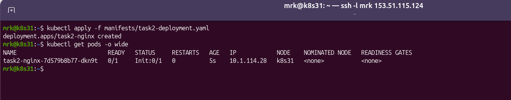
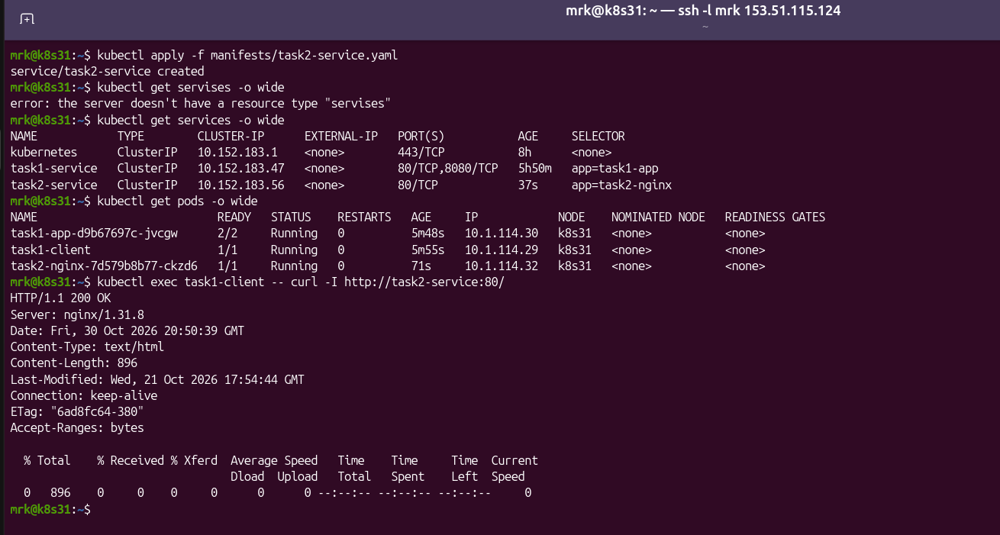

# Домашнее задание к занятию «Запуск приложений в K8S»
Домашнее задание выполнено в тестовой среде на базе MicroK8s.

## Используемое окружение

- ОС: Ubuntu 24.04 LTS
- Kubernetes: MicroK8s 1.35.6
- Container Runtime: containerd 2.1.6
- Управление кластером: kubectl 1.35.6
- Сетевой плагин: Calico
- DNS: CoreDNS
- Узел Kubernetes: `k8s`
- IP-адрес узла: `153.51.115.124`

## Структура репозитория

```text
.
├── README.md
└── manifests
    ├── task1-deployment.yaml
    ├── task1-multitool-pod.yaml
    ├── task1-service.yaml
    ├── task2-deployment.yaml
    └── task2-service.yaml
 ```

# Задание 1. Deployment, состоящий из nginx и multitool

## Создание Deployment

Был создан Deployment с двумя контейнерами:

- `nginx`;
- `wbitt/network-multitool`.

Манифест:

[task1-deployment.yaml](./manifests/task1-deployment.yaml)

Изначально оба контейнера использовали TCP-порт `80`.

Контейнеры внутри одного Pod используют общее сетевое пространство имён и общий IP-адрес. Поэтому два приложения внутри одного Pod не могут одновременно прослушивать один и тот же TCP-порт.

После запуска Deployment контейнер nginx успешно занял порт `80`, а контейнер multitool завершился с ошибкой:

```text
bind() to 0.0.0.0:80 failed (98: Address in use)
nginx: [emerg] still could not bind()
```

Pod находился в состоянии:

```text
NAME                         READY   STATUS   RESTARTS
task1-app-5575dc5d9-l5fqh   1/2     Error    3
```

Скриншот ошибки:


## Исправление конфликта портов

Для контейнера multitool были заданы переменные окружения:

```yaml
env:
  - name: HTTP_PORT
    value: "8080"
  - name: HTTPS_PORT
    value: "8443"
```

После изменения портов приложения внутри Pod используют:

- nginx — TCP-порт `80`;
- multitool HTTP — TCP-порт `8080`;
- multitool HTTPS — TCP-порт `8443`.

После применения исправленного манифеста Pod успешно запустился:

```text
NAME                        READY   STATUS    RESTARTS
task1-app-fb85f46b5-xj8r8   2/2     Running   0
```

Список прослушиваемых портов внутри Pod:

```text
LISTEN 0 511 0.0.0.0:8080
LISTEN 0 511 0.0.0.0:8443
LISTEN 0 511 0.0.0.0:80
```

Проверка nginx:

```text
HTTP/1.1 200 OK
Server: nginx/1.31.3
```

Проверка multitool:

```text
WBITT Network MultiTool (with NGINX) -
task1-app-fb85f46b5-xj8r8 -
10.1.114.21 -
HTTP: 8080, HTTPS: 8443
```

Скриншот успешного запуска Pod после исправления конфликта портов:


## Масштабирование Deployment

До масштабирования Deployment содержал одну реплику:

```text
NAME        READY   UP-TO-DATE   AVAILABLE
task1-app   1/1     1            1
```

Количество реплик было увеличено командой:

```bash
kubectl scale deployment task1-app --replicas=2
```

После масштабирования Deployment содержит две доступные реплики:

```text
NAME        READY   UP-TO-DATE   AVAILABLE
task1-app   2/2     2            2
```

Запущенные Pod:

```text
NAME                        READY   STATUS    RESTARTS   IP
task1-app-fb85f46b5-ngtfb   2/2     Running   0          10.1.114.24
task1-app-fb85f46b5-xj8r8   2/2     Running   0          10.1.114.23
```

Скриншот состояния до и после масштабирования:


## Создание Service

Для доступа к репликам Deployment был создан Service типа `ClusterIP`.

Манифест:

[task1-service.yaml](./manifests/task1-service.yaml)

Service предоставляет два порта:

| Имя порта | Порт Service | TargetPort | Назначение |
|---|---:|---|---|
| nginx-http | 80 | nginx-http | nginx |
| multitool-http | 8080 | multitool-http | multitool |

Состояние Service:

```text
NAME            TYPE        CLUSTER-IP      PORT(S)
task1-service   ClusterIP   10.152.183.47   80/TCP,8080/TCP
```

EndpointSlice содержит IP-адреса обеих реплик:

```text
NAME                  ADDRESSES
task1-service-ls6t4   [10.1.114.23],[10.1.114.24]
```

## Создание отдельного Pod с multitool

Для проверки сетевого доступа был создан отдельный Pod `task1-client`.

Манифест:

[task1-multitool-pod.yaml](./manifests/task1-multitool-pod.yaml)

Состояние Pod:

```text
NAME           READY   STATUS    RESTARTS   IP
task1-client   1/1     Running   0          10.1.114.25
```

Внутреннее DNS-имя Service успешно разрешается:

```text
Name:    task1-service.default.svc.cluster.local
Address: 10.152.183.47
```

Проверка nginx из отдельного Pod:

```bash
kubectl exec task1-client -- curl -I http://task1-service:80/
```

Результат:

```text
HTTP/1.1 200 OK
Server: nginx/1.31.8
```

Проверка multitool из отдельного Pod:

```bash
kubectl exec task1-client -- curl http://task1-service:8080/
```

Результат:

```text
WBITT Network MultiTool (with NGINX) -
task1-app-fb85f46b5-ngtfb -
10.1.114.24 -
HTTP: 8080, HTTPS: 8443
```

При выполнении нескольких запросов Service распределил подключения между двумя репликами:

```text
task1-app-fb85f46b5-ngtfb
task1-app-fb85f46b5-xj8r8
```

Скриншот Service, EndpointSlice, отдельного Pod и результатов запросов:


# Задание 2. Запуск nginx после появления Service

## Создание Deployment с Init-контейнером

Был создан Deployment с основным контейнером nginx и Init-контейнером на базе BusyBox.

Манифест:

[task2-deployment.yaml](./manifests/task2-deployment.yaml)

Init-контейнер выполняет проверку DNS-имени Service:

```sh
until nslookup task2-service.default.svc.cluster.local; do
  echo "Service task2-service is not available yet"
  sleep 2
done
```

Основной контейнер nginx запускается только после успешного завершения Init-контейнера.

## Состояние до создания Service

Deployment был применён до создания `task2-service`.

Состояние Pod:

```text
NAME                           READY   STATUS     RESTARTS
task2-nginx-7d579b8b77-dkn9t   0/1     Init:0/1   0
```

Init-контейнер был запущен и ожидал появления DNS-имени Service:

```text
server can't find task2-service.default.svc.cluster.local: NXDOMAIN
Service task2-service is not available yet
```

Основной контейнер nginx ещё не был запущен:

```text
nginx | ready=false | waiting=PodInitializing
```

Попытка получить журнал nginx возвращала:

```text
container "nginx" is waiting to start: PodInitializing
```

Скриншот состояния до создания Service:



## Создание Service

Был создан Service типа `ClusterIP`.

Манифест:

[task2-service.yaml](./manifests/task2-service.yaml)

Service имеет следующие параметры:

```text
NAME            TYPE        CLUSTER-IP       PORT(S)
task2-service   ClusterIP   10.152.183.232   80/TCP
```

После создания Service его DNS-имя стало доступно:

```text
Name:    task2-service.default.svc.cluster.local
Address: 10.152.183.232
```

Init-контейнер успешно завершил работу:

```text
wait-for-service | ready=true | exit-code=0 | reason=Completed
```

В журнале Init-контейнера появилось сообщение:

```text
Service task2-service is available
```

После завершения Init-контейнера был запущен основной контейнер nginx.

Состояние Pod:

```text
NAME                           READY   STATUS    RESTARTS
task2-nginx-7d579b8b77-dkn9t   1/1     Running   0
```

EndpointSlice Service:

```text
NAME                  ADDRESSES     READY   PORTS
task2-service-jpfv9   [10.1.114.25]   true    80
```

Проверка nginx через Service:

```bash
kubectl exec task1-client -- curl -I http://task2-service:80/
```

Результат:

```text
HTTP/1.1 200 OK
Server: nginx/1.31.3
```

Скриншот состояния после создания Service:



# Итог

В ходе выполнения домашнего задания были продемонстрированы:

- запуск нескольких контейнеров внутри одного Pod;
- конфликт TCP-портов внутри общего сетевого пространства Pod;
- изменение портов контейнера через переменные окружения;
- масштабирование Deployment с одной до двух реплик;
- создание Service типа ClusterIP;
- доступ к приложению из отдельного Pod;
- разрешение внутренних DNS-имён Kubernetes;
- распределение запросов между репликами Deployment;
- использование Init-контейнера;
- блокировка запуска основного контейнера до выполнения заданного условия;
- запуск nginx после появления требуемого Service.
