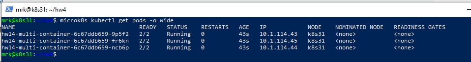
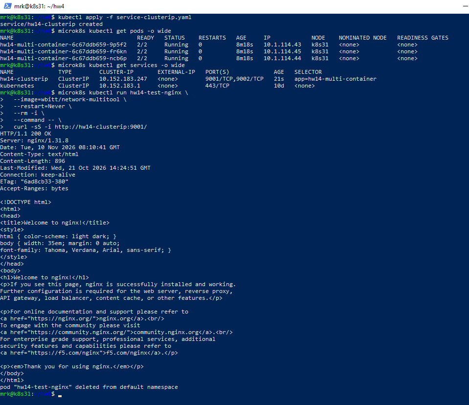
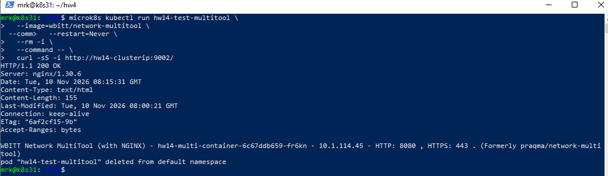
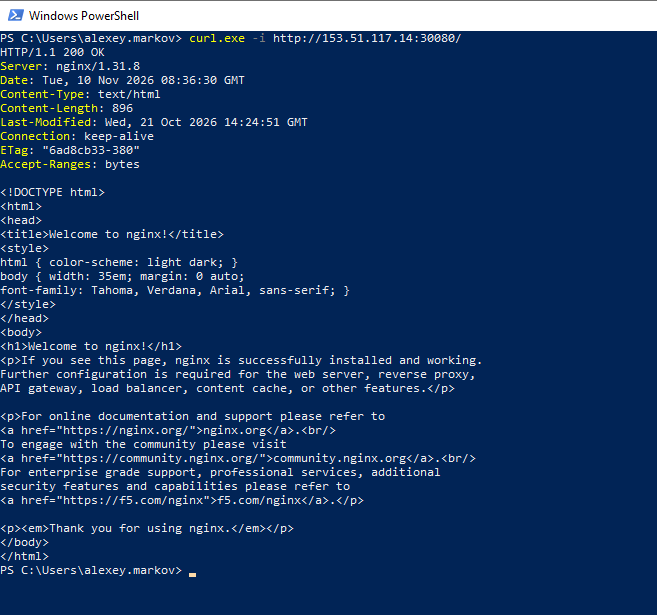
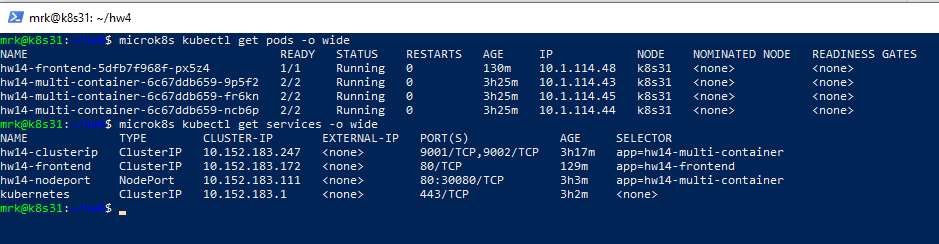
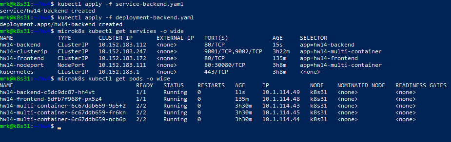

# Домашнее задание к занятию «Сетевое взаимодействие в Kubernetes»

Домашнее задание выполнено в одноузловом кластере MicroK8s.

## Параметры стенда

```text
Kubernetes:         v1.35.6
Node:               k8s
Node IP:            153.51.117.14
ОС:                 Ubuntu 24.04 LTS
CNI:                Calico
Ingress Controller: Traefik
```

---

# Задание 1

Необходимо создать Deployment с тремя репликами, в каждом Pod которого работают два контейнера:

- `nginx` на порту `80`;
- `wbitt/network-multitool` на порту `8080`.

Также необходимо предоставить доступ к приложениям через `ClusterIP` и `NodePort`.

## Deployment

Манифест:

[`deployment-multi-container.yaml`](deployment-multi-container.yaml)

Создан Deployment:

```text
hw14-multi-container
```

Количество реплик:

```text
3
```

В каждом Pod находятся два контейнера:

```text
nginx                       TCP/80
wbitt/network-multitool     TCP/8080
```

Для `network-multitool` используется переменная окружения:

```yaml
env:
  - name: HTTP_PORT
    value: "8080"
```

После запуска Deployment состояние было следующим:

```text
NAME                   READY   UP-TO-DATE   AVAILABLE
hw14-multi-container   3/3     3            3
```

Все три Pod успешно запущены:

```text
READY   STATUS
2/2     Running
2/2     Running
2/2     Running
```


---

## ClusterIP Service

Манифест:

[`service-clusterip.yaml`](service-clusterip.yaml)

Создан Service:

```text
hw14-clusterip
```

Используется следующая схема портов:

```text
hw14-clusterip:9001 -> nginx:80
hw14-clusterip:9002 -> multitool:8080
```

Фактическое состояние Service:

```text
NAME             TYPE        CLUSTER-IP      PORT(S)
hw14-clusterip   ClusterIP   10.152.183.247   9001/TCP,9002/TCP
```

### Проверка nginx

Запрос выполнялся из временного Pod внутри Kubernetes:

```bash
microk8s kubectl run hw14-test-nginx \
  --image=wbitt/network-multitool \
  --restart=Never \
  --rm -i \
  --command -- \
  curl -sS -i http://hw14-clusterip:9001/
```

Результат:

```text
HTTP/1.1 200 OK
Server: nginx/1.31.8

Welcome to nginx!
```


### Проверка Network MultiTool

```bash
microk8s kubectl run hw14-test-multitool \
  --image=wbitt/network-multitool \
  --restart=Never \
  --rm -i \
  --command -- \
  curl -sS -i http://hw14-clusterip:9002/
```

Результат:

```text
HTTP/1.1 200 OK

WBITT Network MultiTool (with NGINX)
HTTP: 8080
```



---

## NodePort Service

Манифест:

[`service-nodeport.yaml`](service-nodeport.yaml)

Создан Service типа `NodePort`:

```text
NAME            TYPE       CLUSTER-IP       PORT(S)
hw14-nodeport   NodePort   10.152.183.111   80:30080/TCP
```

Используемый NodePort:

```text
30080/TCP
```

Проверка:

```bash
 curl.exe -i http://153.51.117.14:30080/
```

Результат:

```text
HTTP/1.1 200 OK
Server: nginx/1.31.8

Welcome to nginx!
```

Таким образом nginx доступен снаружи Kubernetes через IP узла и NodePort.




---
# Задание 2

Необходимо создать:

- frontend на базе nginx;
- backend на базе `wbitt/network-multitool`;
- отдельный Service для каждого приложения;
- Ingress со следующей маршрутизацией:

```text
/     -> frontend
/api  -> backend
```

---

## Frontend

Deployment:

[`deployment-frontend.yaml`](deployment-frontend.yaml)

Service:

[`service-frontend.yaml`](service-frontend.yaml)

Используемый контейнер:

```text
nginx
```

Состояние:

```text
hw14-frontend   1/1   Running
```

Service:

```text
NAME            TYPE        PORT
hw14-frontend   ClusterIP   80/TCP
```


---

## Backend

Deployment:

[`deployment-backend.yaml`](deployment-backend.yaml)

Service:

[`service-backend.yaml`](service-backend.yaml)

Используемый образ:

```text
wbitt/network-multitool
```

Контейнер слушает:

```text
HTTP: 8080
```

Service предоставляет backend внутри Kubernetes на порту `80`:

```text
Service:80 -> Pod:8080
```

Состояние:

```text
hw14-backend   1/1   Running
```


---

# Ingress

Манифест:

[`ingress.yaml`](ingress.yaml)

В используемой версии MicroK8s addon `ingress` развёрнут на базе **Traefik**.

В кластере созданы IngressClass:

```text
nginx
public
traefik
```

В данном задании используется:

```yaml
ingressClassName: traefik
```

Настроена маршрутизация:

```text
/     -> hw14-frontend:80
/api  -> hw14-backend:80 -> container:8080
```

Фактическое описание Ingress:

```text
Path    Backend
/api    hw14-backend:80
/       hw14-frontend:80
```
---

## Middleware для `/api`

Так как текущий MicroK8s использует Traefik, для удаления префикса `/api` перед передачей запроса backend применяется Traefik Middleware:

```yaml
apiVersion: traefik.io/v1alpha1
kind: Middleware
metadata:
  name: hw14-strip-api
  namespace: default
spec:
  stripPrefix:
    prefixes:
      - /api
```

Ingress подключает Middleware:

```yaml
traefik.ingress.kubernetes.io/router.middlewares: default-hw14-strip-api@kubernetescrd
```

Схема обработки запроса:

```text
Client
  |
  | GET /api
  v
Traefik Ingress
  |
  | StripPrefix /api
  v
hw14-backend:80
  |
  v
multitool:8080
```

---

## Проверка frontend через Ingress

Команда:

```bash
curl -i http://153.51.117.14/
```

Результат:

```text
HTTP/1.1 200 OK
Server: nginx/1.31.8

Welcome to nginx!
```

### Скриншот


---

## Проверка backend через Ingress

Команда:

```bash
curl -i http://153.51.117.14/api
```

Результат:

```text
HTTP/1.1 200 OK

WBITT Network MultiTool (with NGINX)
HTTP: 8080
```

Запрос `/api` успешно проходит через Ingress и направляется в backend-приложение.

### Скриншот


---

# Итоговая схема

```text
                         Kubernetes Node
                         153.51.117.14
                               |
              +----------------+----------------+
              |                                 |
              |                                 |
        NodePort :30080                    Traefik Ingress
              |                                 |
              v                     +-----------+-----------+
            nginx                   |                       |
                                    | /                     | /api
                                    v                       v
                             hw14-frontend           hw14-backend
                                  :80                     :80
                                    |                       |
                                    v                       v
                               nginx:80              multitool:8080
```

---

# Файлы домашнего задания

```text
.
├── README.md
├── deployment-multi-container.yaml
├── service-clusterip.yaml
├── service-nodeport.yaml
├── deployment-frontend.yaml
├── deployment-backend.yaml
├── service-frontend.yaml
├── service-backend.yaml
└── ingress.yaml
```

---

# Проверка ресурсов

Основные команды для проверки:

```bash
microk8s kubectl get deployments
microk8s kubectl get pods -o wide
microk8s kubectl get svc
microk8s kubectl get ingress
microk8s kubectl get ingressclass
```

Проверка задания 1:

```bash
curl http://153.51.117.14:30080/
```

Проверка задания 2:

```bash
curl http://153.51.117.14/
curl http://153.51.117.14/api
```

Все созданные Deployment, Service и Ingress были успешно запущены и протестированы.
