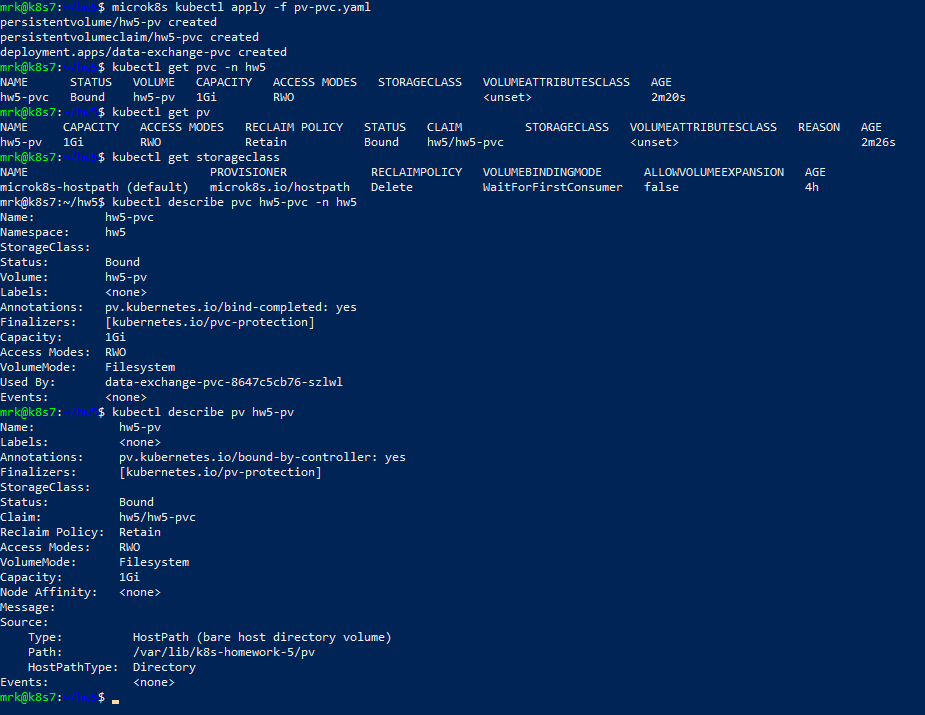
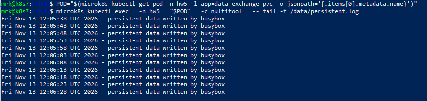
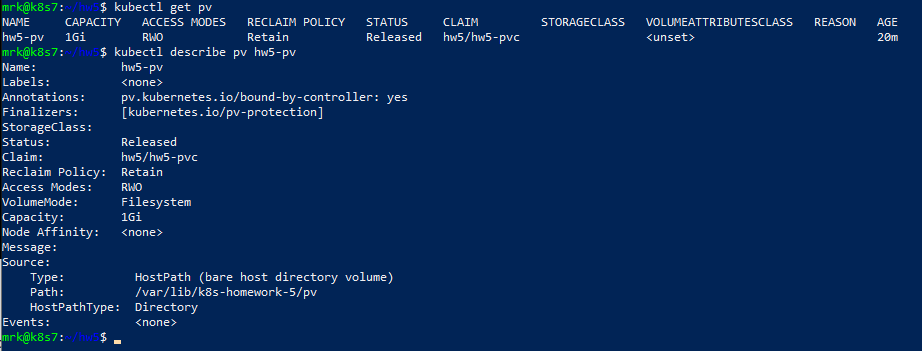
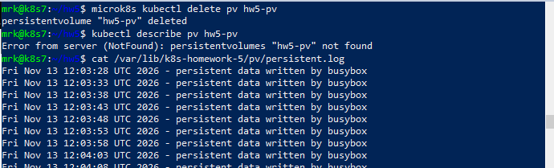
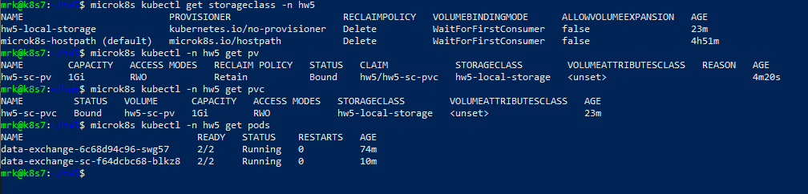
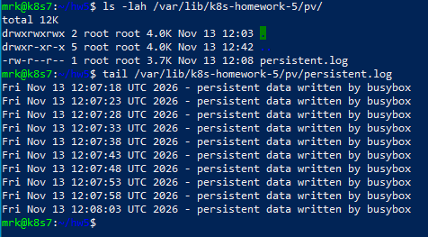

# Домашнее задание к занятию «Хранение в K8s»

Домашняя работа выполнена в одновузловом кластере MicroK8s.

## Параметры стенда

```text
Kubernetes:  v1.36.2
Node:        k8s7
Node IP:     51.250.44.217
OS:          Ubuntu 26.04 LTS
Namespace:   hw5
```

Для изоляции от предыдущих домашних работ все namespace-scoped ресурсы этого задания размещены в отдельном namespace `hw5`. Cluster-scoped ресурсы используют префикс `hw5-`.

---

# Задание 1. Volume: обмен данными между контейнерами в Pod

Создан Deployment из двух контейнеров:

- `busybox`;
- `wbitt/network-multitool`.

`busybox` записывает данные каждые 5 секунд в общий файл `/data/shared.log`, а `multitool` читает тот же файл.

Манифест:

[`containers-data-exchange.yaml`](containers-data-exchange.yaml)

Оба контейнера монтируют один `emptyDir`:

```yaml
volumes:
  - name: shared-data
    emptyDir: {}
```

`busybox` выполняет:

```sh
while true; do
  echo "$(date) - data written by busybox" >> /data/shared.log
  sleep 5
done
```

После запуска Pod находится в состоянии `2/2 Running`.

В `kubectl describe pod` видно два контейнера, mount `/data` у каждого и volume:

```text
shared-data:
  Type: EmptyDir
```


Проверка чтения из контейнера `multitool`:

```bash
POD="$(microk8s kubectl get pod -n hw5 -l app=data-exchange -o jsonpath='{.items[0].metadata.name}')"

microk8s kubectl exec   -n hw5   "$POD"   -c multitool   -- tail -f /data/shared.log
```

Новые строки появляются примерно каждые 5 секунд.


## Пояснение

`emptyDir` создаётся вместе с Pod и доступен всем контейнерам этого Pod. Он подходит для временного обмена файлами между контейнерами. При удалении Pod данные `emptyDir` удаляются вместе с ним.

---

# Задание 2. PersistentVolume и PersistentVolumeClaim

Созданы:

- PersistentVolume `hw5-pv`;
- PersistentVolumeClaim `hw5-pvc`;
- Deployment `data-exchange-pvc`.

Манифест:

[`pv-pvc.yaml`](pv-pvc.yaml)

Локальное хранилище на ноде:

```text
/var/lib/k8s-homework-5/pv
```

PV использует:

```yaml
hostPath:
  path: /var/lib/k8s-homework-5/pv
  type: Directory
```

Основные параметры PV:

```text
Capacity:        1Gi
Access mode:     ReadWriteOnce
Reclaim policy:  Retain
Volume mode:     Filesystem
```

PVC запрашивает `512Mi` и явно привязывается к `hw5-pv`.

Для статического PV без StorageClass у PV и PVC используется:

```yaml
storageClassName: ""
```

После создания:

```text
hw5-pv    Bound
hw5-pvc   Bound
Pod        2/2 Running
```



`busybox` записывает данные в `/data/persistent.log`, а `multitool` читает тот же файл:

```bash
POD="$(microk8s kubectl get pod -n hw5 -l app=data-exchange-pvc -o jsonpath='{.items[0].metadata.name}')"

microk8s kubectl exec   -n hw5   "$POD"   -c multitool   -- tail -f /data/persistent.log
```



Файл физически расположен на Kubernetes-ноде:

```text
/var/lib/k8s-homework-5/pv/persistent.log
```

## Удаление Deployment и PVC

В рамках задания были удалены:

```bash
microk8s kubectl delete deployment data-exchange-pvc -n hw5
microk8s kubectl delete pvc hw5-pvc -n hw5
```

После удаления PVC PV перешёл в состояние:

```text
Status:          Released
Reclaim Policy:  Retain
Claim:           hw5/hw5-pvc
```



### Почему PV стал Released

Политика `Retain` не удаляет backing storage автоматически после удаления PVC. PVC исчезает, PV больше не связан с существующим claim и переходит в `Released`. Данные остаются на диске и требуют ручного управления администратором.

## Удаление PV

После проверки PV был удалён:

```bash
microk8s kubectl delete pv hw5-pv
```

Kubernetes-объект PV исчез, но файл:

```text
/var/lib/k8s-homework-5/pv/persistent.log
```

остался на локальном диске ноды.



### Почему файл сохранился

PV — Kubernetes-объект, описывающий хранилище. Сам файл находится в каталоге `hostPath` на ноде. При политике `Retain` удаление PV не очищает содержимое этого каталога; физическая очистка выполняется вручную.

---

# Задание 3. StorageClass

Созданы:

- StorageClass `hw5-local-storage`;
- PersistentVolume `hw5-sc-pv`;
- PersistentVolumeClaim `hw5-sc-pvc`;
- Deployment `data-exchange-sc`.

Манифест:

[`sc.yaml`](sc.yaml)

StorageClass:

```yaml
apiVersion: storage.k8s.io/v1
kind: StorageClass
metadata:
  name: hw5-local-storage
provisioner: kubernetes.io/no-provisioner
volumeBindingMode: WaitForFirstConsumer
```

`kubernetes.io/no-provisioner` не создаёт PV автоматически, поэтому local PV создаётся статически.

Локальный путь:

```text
/var/lib/k8s-homework-5/sc
```

PV использует:

```yaml
local:
  path: /var/lib/k8s-homework-5/sc
```

Для привязки local volume к физической ноде задан `nodeAffinity`:

```yaml
nodeAffinity:
  required:
    nodeSelectorTerms:
      - matchExpressions:
          - key: kubernetes.io/hostname
            operator: In
            values:
              - k8s
```

После запуска:

```text
hw5-local-storage   kubernetes.io/no-provisioner   WaitForFirstConsumer
hw5-sc-pv           Bound
hw5-sc-pvc          Bound
data-exchange-sc-*   2/2 Running
```



## Reclaim policy

В выводе самого StorageClass отображается `RECLAIMPOLICY: Delete`, поскольку поле `reclaimPolicy` в StorageClass явно не задавалось.

При этом используется `kubernetes.io/no-provisioner`, то есть динамического создания PV нет. Статический PV `hw5-sc-pv` имеет собственную явно заданную политику:

```yaml
persistentVolumeReclaimPolicy: Retain
```

Поэтому фактическая reclaim policy используемого PV — `Retain`.

## Проверка данных

`busybox` пишет данные в:

```text
/data/storageclass.log
```

`multitool` читает тот же файл:

```bash
POD="$(microk8s kubectl get pod -n hw5 -l app=data-exchange-sc -o jsonpath='{.items[0].metadata.name}')"

microk8s kubectl exec   -n hw5   "$POD"   -c multitool   -- tail -f /data/storageclass.log
```

Новые строки появляются примерно каждые 5 секунд.

Тот же файл присутствует на ноде:

```text
/var/lib/k8s-homework-5/sc/storageclass.log
```



---

# Итог

В ходе работы проверены три механизма хранения Kubernetes:

| Задание | Тип хранения | Результат |
|---|---|---|
| 1 | `emptyDir` | Обмен файлами между контейнерами одного Pod |
| 2 | Статический PV + PVC + `hostPath` | Проверены `Bound`, `Released`, `Retain` и сохранение файлов |
| 3 | StorageClass + local PV + PVC | Проверены `no-provisioner`, `WaitForFirstConsumer` и `nodeAffinity` |

Ключевые результаты:

- `busybox` и `multitool` успешно обмениваются данными через `emptyDir`;
- статический PV/PVC успешно связываются в состоянии `Bound`;
- после удаления PVC PV с политикой `Retain` переходит в `Released`;
- файл сохраняется после удаления PVC и после удаления объекта PV;
- StorageClass `hw5-local-storage` работает с `kubernetes.io/no-provisioner`;
- local PV связан с нодой `k8s` через `nodeAffinity`;
- приложение через StorageClass/PVC успешно использует persistent data.

---

# Структура задания

```text
.
├── README.md
├── containers-data-exchange.yaml
├── pv-pvc.yaml
└── sc.yaml
```

# Проверка

Задание 1:

```bash
microk8s kubectl get deployment data-exchange -n hw5
microk8s kubectl get pods -n hw5 -l app=data-exchange
```

Задание 2 было намеренно очищено по условию работы. Сохранённый файл можно проверить:

```bash
ls -lah /var/lib/k8s-homework-5/pv/
tail /var/lib/k8s-homework-5/pv/persistent.log
```

Для повторного создания:

```bash
microk8s kubectl apply -f pv-pvc.yaml
```

Задание 3:

```bash
microk8s kubectl get storageclass hw5-local-storage
microk8s kubectl get pv hw5-sc-pv
microk8s kubectl get pvc hw5-sc-pvc -n hw21
microk8s kubectl get pods -n hw5 -l app=data-exchange-sc
```

Все задания выполнены, а результаты подтверждены скриншотами.
