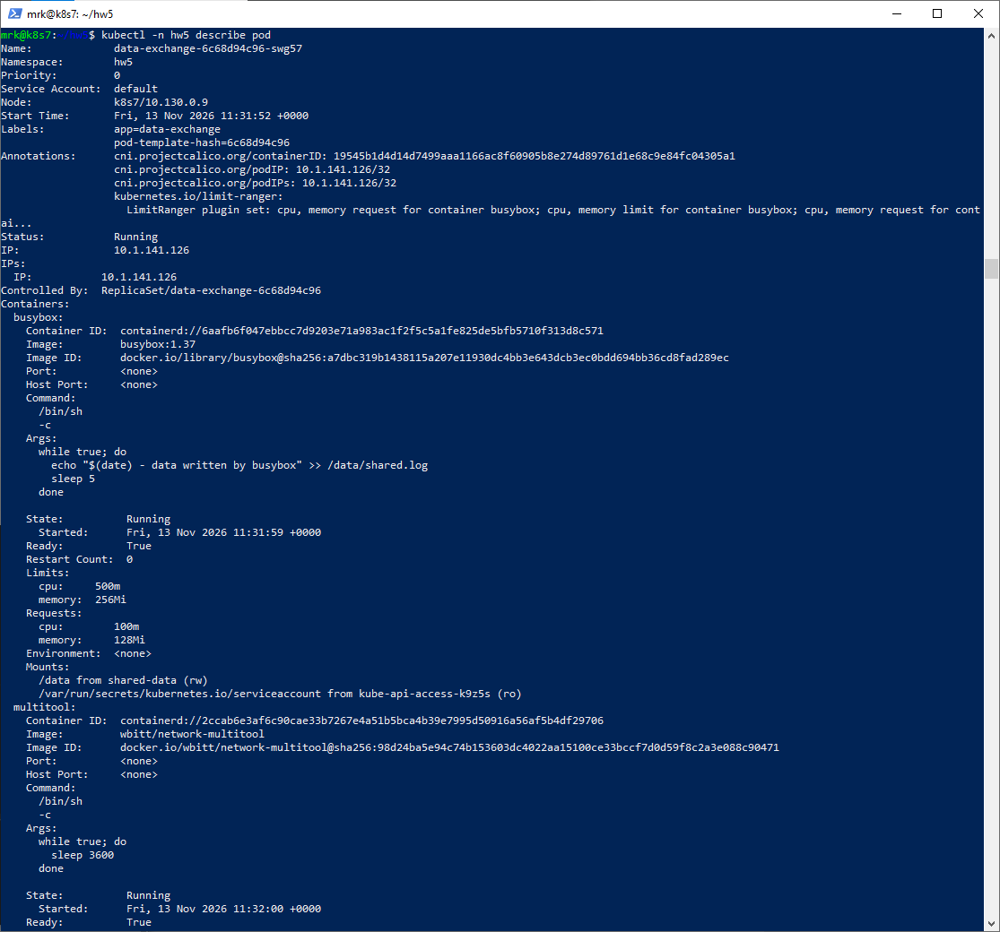
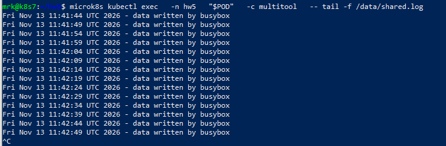

# Домашнее задание к занятию «Хранение в K8s»

Домашняя работа выполнена в одновузловом кластере MicroK8s.

## Параметры стенда

```text
Kubernetes:  v1.36.2
Node:        k8s
Node IP:     51.250.44.217
OS:          Ubuntu 26.04 LTS
Namespace:   hw5
```

Для изоляции от предыдущих домашних работ все namespace-scoped ресурсы этого задания размещены в отдельном namespace `hw5`. Cluster-scoped ресурсы используют префикс `hw5-`.

---

# Задание 1. Volume: обмен данными между контейнерами в Pod

Создан Deployment из двух контейнеров:

- `busybox`;
- `wbitt/network-multitool`.

`busybox` записывает данные каждые 5 секунд в общий файл `/data/shared.log`, а `multitool` читает тот же файл.

Манифест:

[`containers-data-exchange.yaml`](containers-data-exchange.yaml)

Оба контейнера монтируют один `emptyDir`:

```yaml
volumes:
  - name: shared-data
    emptyDir: {}
```

`busybox` выполняет:

```sh
while true; do
  echo "$(date) - data written by busybox" >> /data/shared.log
  sleep 5
done
```

После запуска Pod находится в состоянии `2/2 Running`.

В `kubectl describe pod` видно два контейнера, mount `/data` у каждого и volume:

```text
shared-data:
  Type: EmptyDir
```



Проверка чтения из контейнера `multitool`:

```bash
POD="$(microk8s kubectl get pod -n hw21 -l app=data-exchange -o jsonpath='{.items[0].metadata.name}')"

microk8s kubectl exec   -n hw21   "$POD"   -c multitool   -- tail -f /data/shared.log
```

Новые строки появляются примерно каждые 5 секунд.



## Пояснение

`emptyDir` создаётся вместе с Pod и доступен всем контейнерам этого Pod. Он подходит для временного обмена файлами между контейнерами. При удалении Pod данные `emptyDir` удаляются вместе с ним.

---

# Задание 2. PersistentVolume и PersistentVolumeClaim

Созданы:

- PersistentVolume `hw21-pv`;
- PersistentVolumeClaim `hw21-pvc`;
- Deployment `data-exchange-pvc`.

Манифест:

[`pv-pvc.yaml`](pv-pvc.yaml)

Локальное хранилище на ноде:

```text
/var/lib/k8s-homework-2.1/pv
```

PV использует:

```yaml
hostPath:
  path: /var/lib/k8s-homework-2.1/pv
  type: Directory
```

Основные параметры PV:

```text
Capacity:        1Gi
Access mode:     ReadWriteOnce
Reclaim policy:  Retain
Volume mode:     Filesystem
```

PVC запрашивает `512Mi` и явно привязывается к `hw21-pv`.

Для статического PV без StorageClass у PV и PVC используется:

```yaml
storageClassName: ""
```

После создания:

```text
hw21-pv    Bound
hw21-pvc   Bound
Pod        2/2 Running
```


`busybox` записывает данные в `/data/persistent.log`, а `multitool` читает тот же файл:

```bash
POD="$(microk8s kubectl get pod -n hw21 -l app=data-exchange-pvc -o jsonpath='{.items[0].metadata.name}')"

microk8s kubectl exec   -n hw21   "$POD"   -c multitool   -- tail -f /data/persistent.log
```


Файл физически расположен на Kubernetes-ноде:

```text
/var/lib/k8s-homework-2.1/pv/persistent.log
```

## Удаление Deployment и PVC

В рамках задания были удалены:

```bash
microk8s kubectl delete deployment data-exchange-pvc -n hw21
microk8s kubectl delete pvc hw21-pvc -n hw21
```

После удаления PVC PV перешёл в состояние:

```text
Status:          Released
Reclaim Policy:  Retain
Claim:           hw21/hw21-pvc
```


### Почему PV стал Released

Политика `Retain` не удаляет backing storage автоматически после удаления PVC. PVC исчезает, PV больше не связан с существующим claim и переходит в `Released`. Данные остаются на диске и требуют ручного управления администратором.

## Удаление PV

После проверки PV был удалён:

```bash
microk8s kubectl delete pv hw21-pv
```

Kubernetes-объект PV исчез, но файл:

```text
/var/lib/k8s-homework-2.1/pv/persistent.log
```

остался на локальном диске ноды.


### Почему файл сохранился

PV — Kubernetes-объект, описывающий хранилище. Сам файл находится в каталоге `hostPath` на ноде. При политике `Retain` удаление PV не очищает содержимое этого каталога; физическая очистка выполняется вручную.

---

# Задание 3. StorageClass
