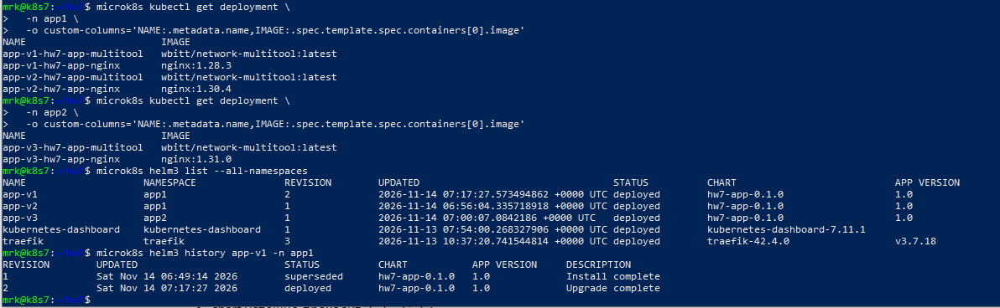
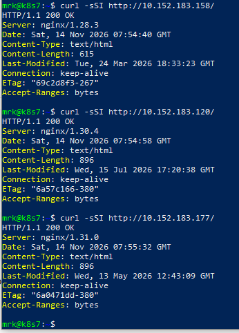

# Домашнее задание к занятию «Helm»

Домашняя работа выполнена в Kubernetes-кластере MicroK8s.

## Параметры стенда

```text
Kubernetes:  v1.35.6
Node:        k8s7
Node IP:     51.250.44.217
OS:          Ubuntu 26.04 LTS
Helm:        v3.20.2
```

Для работы использовался встроенный Helm:

```bash
microk8s helm3
```

---

# Задание 1. Подготовить Helm-чарт для приложения

## Структура чарта

Создан Helm chart:

```text
hw7-app/
├── Chart.yaml
├── values.yaml
└── templates/
    ├── _helpers.tpl
    ├── nginx-deployment.yaml
    ├── nginx-service.yaml
    ├── multitool-deployment.yaml
    └── multitool-service.yaml
```

Каждый компонент приложения разворачивается отдельным Deployment:

- `nginx`;
- `wbitt/network-multitool`.

Для каждого Deployment создан отдельный Service.

## Chart.yaml

Основные параметры:

```yaml
apiVersion: v2
name: hw7-app
description: Netology Kubernetes Helm homework 7
type: application
version: 0.1.0
appVersion: "1.0"
```

## Values

Версии контейнеров задаются через `values.yaml`.

Пример:

```yaml
nginx:
  replicaCount: 1
  image:
    repository: nginx
    tag: "1.28.0"
    pullPolicy: IfNotPresent
```

В шаблоне Deployment используется:

```yaml
image: "{{ .Values.nginx.image.repository }}:{{ .Values.nginx.image.tag }}"
```

Таким образом версия приложения меняется не правкой Deployment, а изменением values.

## Уникальные имена ресурсов

Для возможности устанавливать несколько копий одного чарта одновременно имена ресурсов формируются с использованием Helm release name:

```gotemplate
{{- printf "%s-%s" .Release.Name .Chart.Name }}
```

Например:

```text
app-v1-hw7-app-nginx
app-v2-hw7-app-nginx
app-v3-hw7-app-nginx
```

Также label:

```text
app.kubernetes.io/instance
```

содержит имя конкретного Helm release.

Это позволяет нескольким установкам одного чарта существовать без конфликтов.

## Проверка чарта

Выполнена проверка:

```bash
microk8s helm3 lint ./hw7-app
```

Результат:

```text
1 chart(s) linted, 0 chart(s) failed
```

Также проверен рендеринг:

```bash
microk8s helm3 template \
  demo \
  ./hw7-app \
  --namespace demo \
  -f values-app1-v1.yaml
```

Рендерятся четыре Kubernetes-ресурса:

```text
Service     multitool
Service     nginx
Deployment  multitool
Deployment  nginx
```

Для nginx подставляется версия из values:

```text
nginx:1.28.0
```

## Упаковка чарта

Чарт успешно упакован:

```bash
microk8s helm3 package ./hw7-app
```

Создан файл:

```text
hw7-app-0.1.0.tgz
```

### Скриншот


---

# Задание 2. Запустить две версии в разных namespace

По условию необходимо:

1. запустить одну версию приложения в `namespace=app1`;
2. запустить вторую версию в том же `namespace=app1`;
3. запустить третью версию в `namespace=app2`.

Для этого использованы три независимых Helm release.

---

## Values для разных версий

Созданы отдельные values-файлы:

```text
values-app1-v1.yaml
values-app1-v1-upgraded.yaml
values-app1-v2.yaml
values-app2-v3.yaml
```

Версии nginx:

```text
app-v1: 1.28.0
app-v2: 1.30.4
app-v3: 1.31.0
```

После установки `app-v1` дополнительно обновляется до:

```text
1.28.3
```

---

## Первый release — app-v1

Установка:

```bash
microk8s helm3 install \
  app-v1 \
  ./hw7-app \
  --namespace app1 \
  --create-namespace \
  -f values-app1-v1.yaml \
  --wait
```


Начальная версия:

```text
nginx:1.28.0
```


---

## Второй release — app-v2

Устанавливается в тот же namespace `app1`:

```bash
microk8s helm3 install \
  app-v2 \
  ./hw7-app \
  --namespace app1 \
  -f values-app1-v2.yaml \
  --wait
```


Версия:

```text
nginx:1.30.4
```


Таким образом в одном namespace одновременно существуют два независимых Helm release.

---

## Третий release — app-v3

Устанавливается в namespace `app2`:

```bash
microk8s helm3 install \
  app-v3 \
  ./hw7-app \
  --namespace app2 \
  --create-namespace \
  -f values-app2-v3.yaml \
  --wait
```


Версия:

```text
nginx:1.31.0
```


---

# Результат установки

Итоговая схема:

```text
namespace app1
├── release app-v1
│   ├── nginx
│   └── multitool
│
└── release app-v2
    ├── nginx
    └── multitool


namespace app2
└── release app-v3
    ├── nginx
    └── multitool
```

Helm:

```text
app-v1  app1  deployed
app-v2  app1  deployed
app-v3  app2  deployed
```

---

# Обновление приложения через Helm

Для демонстрации обновления приложения release `app-v1` был обновлён.

До обновления:

```text
nginx:1.28.0
```

Values:

```yaml
nginx:
  image:
    tag: "1.28.0"
```

Обновление:

```bash
microk8s helm3 upgrade \
  app-v1 \
  ./hw7-app \
  --namespace app1 \
  -f values-app1-v1-upgraded.yaml \
  --wait
```

После обновления:

```text
nginx:1.28.3
```

История Helm:

```text
REVISION  STATUS
1         superseded
2         deployed
```

Это подтверждает, что приложение обновлено через Helm release, а версия изменена через values.

---

# Текущее состояние Deployment

## Namespace app1

```text
app-v1-hw7-app-multitool   wbitt/network-multitool:latest
app-v1-hw7-app-nginx       nginx:1.28.3

app-v2-hw7-app-multitool   wbitt/network-multitool:latest
app-v2-hw7-app-nginx       nginx:1.30.4
```

## Namespace app2

```text
app-v3-hw7-app-multitool   wbitt/network-multitool:latest
app-v3-hw7-app-nginx       nginx:1.31.0
```

### Скриншот Helm releases и Deployment



---

# Проверка приложений

Проверка каждого nginx выполнена через соответствующий ClusterIP Service.

## app-v1

```text
HTTP/1.1 200 OK
Server: nginx/1.28.3
```

## app-v2

```text
HTTP/1.1 200 OK
Server: nginx/1.30.4
```

## app-v3

```text
HTTP/1.1 200 OK
Server: nginx/1.31.0
```

Таким образом подтверждено, что все три версии действительно запущены и обслуживают HTTP-запросы.

### Скриншот



---

# Файлы репозитория

```text
.
├── README.md
├── hw7-app
│   ├── Chart.yaml
│   ├── values.yaml
│   └── templates
│       ├── _helpers.tpl
│       ├── multitool-deployment.yaml
│       ├── multitool-service.yaml
│       ├── nginx-deployment.yaml
│       └── nginx-service.yaml
├── hw24-app-0.1.0.tgz
├── values-app1-v1.yaml
├── values-app1-v1-upgraded.yaml
├── values-app1-v2.yaml
└── values-app2-v3.yaml
 
```

---

# Основные команды проверки

## Helm chart

```bash
microk8s helm3 lint ./hw7-app

microk8s helm3 template \
  demo \
  ./hw7-app \
  --namespace demo \
  -f values-app1-v1.yaml
```

## Helm releases

```bash
microk8s helm3 list --all-namespaces
```

## Deployment

```bash
microk8s kubectl get deployment \
  -n app1 \
  -o custom-columns='NAME:.metadata.name,IMAGE:.spec.template.spec.containers[0].image'

microk8s kubectl get deployment \
  -n app2 \
  -o custom-columns='NAME:.metadata.name,IMAGE:.spec.template.spec.containers[0].image'
```

## Helm history

```bash
microk8s helm3 history app-v1 -n app1
```

## Проверка nginx

```bash
curl -sSI http://<ClusterIP>/
```

---

# Итог

В ходе выполнения домашней работы:

- создан собственный Helm chart;
- nginx и multitool разворачиваются отдельными Deployment;
- версии приложений вынесены в values;
- chart успешно проходит `helm lint`;
- chart успешно рендерится через `helm template`;
- chart упакован в `.tgz`;
- две версии запущены одновременно в namespace `app1`;
- третья версия запущена в namespace `app2`;
- выполнено обновление `app-v1` через `helm upgrade`;
- версия nginx изменена с `1.28.0` на `1.28.3`;
- Helm history содержит две revision;
- все три nginx возвращают HTTP 200;
- результаты подтверждены скриншотами.

